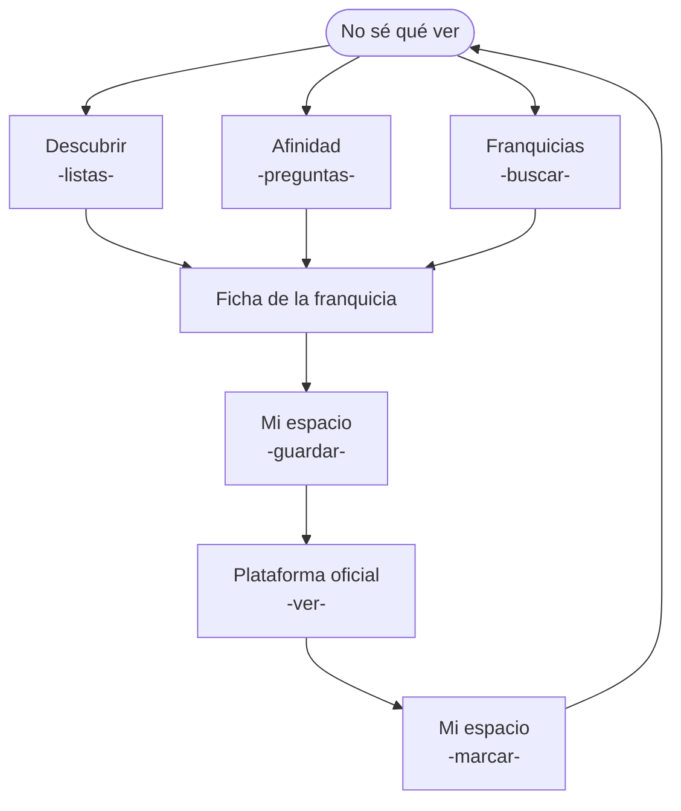
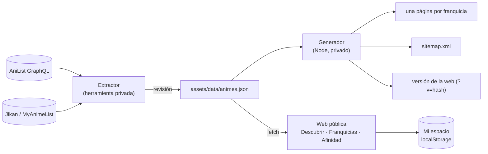

# Espacio Anime

> **Descubre qué obras merecen la pena y averigua exactamente dónde verlas. Encuentra tu serie ideal y lleva el control de todos tus animes.**

**Web:** <https://aaroninf.github.io/espacio-anime/>

Hecha con HTML, CSS y JavaScript: sin frameworks, sin servidor y sin compilación.

---

## Parte 1 — El proyecto

### Por qué existe

Creemos que descubrir buen anime no debería ser tan difícil. Frente al exceso de información y las listas basadas en modas, Espacio Anime apuesta por el criterio propio: franquicias unificadas en una sola ficha, disponibilidad legal en España y recomendaciones certeras sin saturación.

Una web cuidada y en español para disfrutar del anime a tu propio ritmo: una base de datos propia pensada para no perderte entre temporadas sueltas, un recomendador rápido cuando estás en duda, listas temáticas para ampliar tu bagaje y tu propio rincón privado para llevar al día lo que estás viendo, sin registros obligatorios ni complicaciones.

### Los cuatro pilares

- **Descubrir.** Una selección de guías, listas y recomendaciones para ayudarte a elegir qué ver en cada momento.
- **Franquicias.** Explora sagas, consulta fichas y encuentra fácilmente dónde ver cada anime con nuestro catálogo.
- **Afinidad.** ¿No sabes qué ver? Responde 5 preguntas rápidas y encuentra la franquicia que mejor se adapta a ti ahora mismo.
- **Mi espacio.** Lleva el control y el progreso de todos tus animes, guarda tus favoritos, anota los próximos para ver y organízalos en tus propias listas.

Los cuatro pilares no son secciones sueltas, se alimentan entre sí:



### Principios

- **Criterio antes que cantidad.** Muchas franquicias seleccionadas con criterio editorial: no está todo lo que existe, pero todo lo que está merece la pena.
- **Gestionar tu anime, no una red social.** Nada de seguidores, feed, comentarios ni perfiles públicos.
- **Ser intermediario, no plataforma.** Espacio Anime te ayuda a decidir y te lleva a la plataforma oficial. No sustituye a las plataformas oficiales de streaming.
- **Privacidad por defecto y sin monetización.** Sin cuentas, sin cookies y sin publicidad; la analítica es anónima.

---

## Parte 2 — Cómo está hecho

### Arquitectura



- **No backend:** sin servidor propio; la base de datos es un archivo, `animes.json`, que el navegador descarga y consulta él mismo.
- **No build step:** sin compilación; los archivos que se escriben son los que se publican.
- **Shared partials:** el menú, el footer y la portada se escriben una vez y `layout.js` los inserta en cada página.
- **Static hosting:** GitHub Pages; cada `push` a `main` publica la web.

```text
assets/
  data/animes.json          → el catálogo (única fuente de verdad)
  js/modules/
    anime-data.js           → carga del catálogo
    catalogo.js             → buscador, filtros y orden en memoria
    modal-franquicia.js     → ficha de franquicia y navegación entre fichas
    afinidad.js             → motor de recomendación
    mi-espacio.js           → seguimiento personal, exportar / importar
    plataformas.js          → reglas de "dónde ver"
    home.js · layout.js · config.js
pages/                      → Descubrir (listas), Franquicias, Afinidad, Mi espacio
partials/                   → menú, footer y portada
404.html                    → error propio; redirige las fichas aún sin generar
sitemap.xml · robots.txt    → mapa de la web para Google
```

#### Mi espacio: datos del usuario sin servidor

- Seguimiento sin cuentas: se guarda en el propio navegador (`localStorage`), con el estado de cada franquicia y las listas propias.
- Guarda solo el id de cada franquicia, no sus datos: si una ficha cambia (temporadas nuevas, portada, dónde verla), Mi espacio lo muestra al momento.
- Se pasa a otro navegador con una copia en un archivo JSON que se exporta y se importa; antes de sustituir nada, se comprueba y pide confirmación.
- Lo que escribe el usuario se muestra siempre como texto, nunca como código, así que una copia importada no puede colar nada dañino.

### Herramientas

#### 1. El extractor

Herramienta creada con HTML + JavaScript fuera de este repositorio que construye la base de datos a partir de AniList y de Jikan, la API de MyAnimeList, en cuatro pasos:

1. **Candidatas.** Obras de AniList por tres criterios (populares, mejor valoradas y en tendencia), con una popularidad mínima y sin contenido para adultos.
2. **Franquicias.** Sigue secuelas, precuelas, películas y spin-offs y junta cada universo en una sola ficha, sin crossovers, con la serie original como entrada principal.
3. **Calidad.** Entra solo lo que tiene una temporada terminada, votos suficientes para su formato y buena nota ponderada.
4. **Mantenimiento.** Añade temporadas nuevas y próximos estrenos, elige dónde verlas y completa los títulos.

Se genera un nuevo catálogo (`animes.json`) que se revisa y sustituye al anterior.

#### 2. El generador

Un script de Node que se ejecuta antes de cada publicación y prepara la web:

- **Una página por franquicia**, para que Google encuentre cada anime y, al compartirla, salgan su portada y su sinopsis.
- **El mapa de la web** (`sitemap.xml`), la lista de todas las páginas para Google, siempre al día.
- **La versión de la web**: marca cada archivo con una versión, para que tras publicar los navegadores descarguen lo nuevo en vez de usar una copia vieja.


#### 3. Afinidad

Cada franquicia lleva etiquetas editoriales de un **vocabulario cerrado**, lo que permite comprobar **coincidencias exactas** entre la respuesta y la obra.

| Pregunta | Tipo | Puntos |
| --- | --- | --- |
| Vibra ("¿Qué te pide el cuerpo?") | Puntúa | 28 |
| Motor ("¿Qué debe mover la historia?") | Puntúa | 24 |
| Mundo ("¿Dónde quieres entrar?") | Puntúa | 18 |
| Formato (película / serie corta / serie larga) | **Filtro** | 18 |
| Época (clásica / moderna / actual) | **Filtro** | 12 |

- Si la obra tiene la etiqueta que eliges, suma todos los puntos de esa pregunta.
- El máximo es 100, así que el porcentaje que ves es la suma real de puntos.
- Formato y época son filtros: si no coinciden, la obra queda fuera directamente.
- No recomienda lo que ya tienes en Mi espacio como completado, favorito o "no me gusta".

---

## Tecnologías

HTML · CSS · JavaScript · Tailwind CSS · API de AniList (GraphQL) · API de Jikan (MyAnimeList) · Node.js · Git · GitHub Pages

## Autor

Proyecto personal de **Aaron**: idea, contenido, diseño y desarrollo.

Datos de anime: [AniList](https://anilist.co) y [MyAnimeList](https://myanimelist.net) (vía [Jikan](https://jikan.moe)). Espacio Anime no aloja contenido: enlaza a las plataformas oficiales.
